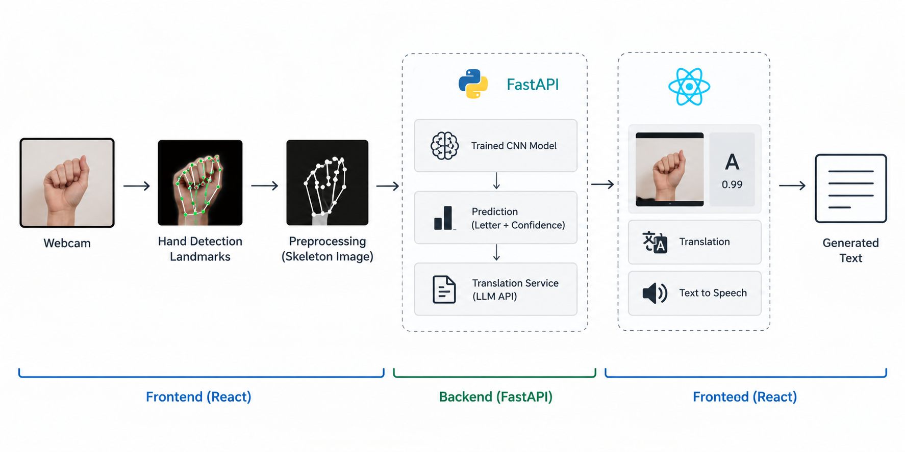
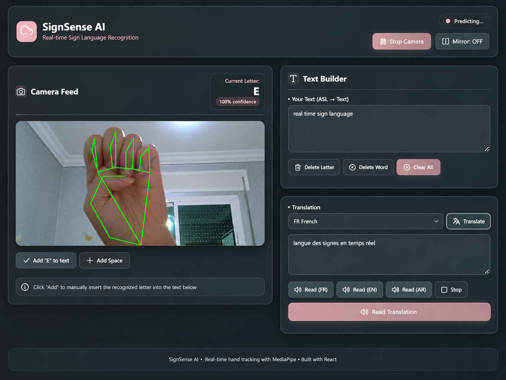
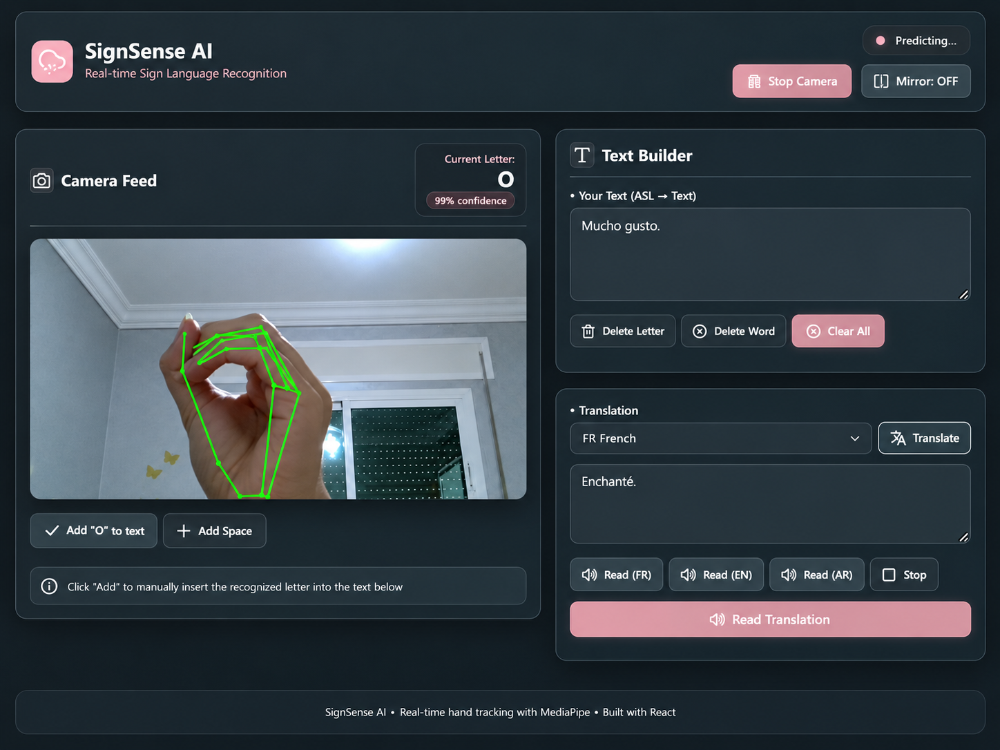

# SignSense AI — Real-Time American Sign Language Recognition

A real-time Computer Vision and Deep Learning application that recognizes American Sign Language (ASL) alphabet gestures from a webcam stream and converts validated predictions into text, translated content, and speech.


---

## Overview

SignSense AI combines real-time hand tracking, image preprocessing, deep-learning inference, text construction, translation, and browser-based speech synthesis in one interactive application.

Instead of classifying the complete webcam frame, the frontend detects the hand with MediaPipe, extracts the 21 hand landmarks, renders a normalized skeleton image, and sends that representation to the FastAPI backend. A TensorFlow/Keras model then predicts the ASL letter and returns its confidence score.

The user can validate recognized letters, build text manually, translate the generated text, and play the result using text-to-speech.

---

## Key Features

- Real-time webcam capture and hand tracking with MediaPipe Hands
- Detection of 21 hand landmarks
- Skeleton-based preprocessing for more focused gesture representation
- ASL letter classification with a TensorFlow/Keras CNN
- Prediction confidence and top-5 class probabilities from the API
- Manual validation before adding predicted letters to text
- Text editing and sentence construction
- Multilingual translation through OpenRouter
- Browser-based text-to-speech
- React + Vite frontend with FastAPI backend

---

## System Architecture

<p align="center">
  
</p>

The application is organized into three main stages:

1. **Frontend processing** — webcam capture, MediaPipe hand detection, landmark extraction, skeleton generation, and user interaction.
2. **Backend inference** — image preprocessing, CNN inference, label decoding, confidence calculation, and translation requests.
3. **User output** — validated text, translated text, and speech synthesis.

---

## Recognition Pipeline

```text
Webcam
  -> Hand Detection (MediaPipe)
  -> 21 Landmark Extraction
  -> Skeleton Rendering
  -> Resize to 64 x 64
  -> Grayscale Conversion
  -> Pixel Normalization
  -> CNN Inference
  -> Predicted ASL Letter
  -> Confidence Score
  -> User Validation
  -> Text Construction
```

The backend preprocessing converts the received image to grayscale, resizes it to `64 x 64`, normalizes pixel values to `[0, 1]`, and reshapes it to `(1, 64, 64, 1)` before inference.

---

## Application Components

### Frontend

Built with **React + Vite**.

Main responsibilities:

- webcam lifecycle management
- MediaPipe Hands integration
- hand-landmark processing
- skeleton image generation
- prediction requests to the backend
- confidence display
- manual letter validation
- text construction and editing
- translation controls
- speech synthesis

### Backend

Built with **FastAPI**.

Main responsibilities:

- Base64 image decoding
- OpenCV preprocessing
- TensorFlow/Keras model loading
- ASL letter inference
- label decoding with the serialized encoder
- confidence and top-5 probability generation
- translation requests through OpenRouter

---

## API Overview

### Health Check

```http
GET /health
```

Example response:

```json
{
  "ok": true
}
```

### Predict an ASL Letter

```http
POST /predict
```

Request body:

```json
{
  "image": "data:image/png;base64,...",
  "session_id": "react_user1"
}
```

Example response:

```json
{
  "label": "A",
  "confidence": 0.99,
  "probs_top5": [
    {
      "label": "A",
      "prob": 0.99
    }
  ]
}
```

### Translate Text

```http
POST /translate
```

Request body:

```json
{
  "text": "HELLO",
  "source": "auto",
  "target": "fr"
}
```

Example response:

```json
{
  "translated_text": "Bonjour"
}
```

---

## Technology Stack

| Layer | Technologies |
|---|---|
| Computer Vision | MediaPipe Hands, OpenCV |
| Deep Learning | TensorFlow, Keras, CNN |
| Backend | Python, FastAPI, Pydantic |
| Frontend | React, Vite, JavaScript, CSS |
| Communication | REST API, JSON |
| Translation | OpenRouter API |
| Speech | Web Speech API |
| Model Artifacts | Keras model, serialized label encoder |

---

## Repository Structure

```text
signsense-ai/
|
|-- backend/
|   |-- app/
|   |   |-- main.py
|   |   |-- model_loader.py
|   |   |-- schemas.py
|   |   |-- services_translate.py
|   |   `-- utils_image.py
|   |
|   |-- models/
|   |   |-- asl_sign_model.keras
|   |   `-- label_encoder.pkl
|   `-- run.bat
|
|-- frontend/
|   |-- src/
|   |   |-- App.jsx
|   |   |-- api.js
|   |   |-- main.jsx
|   |   `-- styles.css
|   |-- index.html
|   |-- package.json
|   |-- package-lock.json
|   |-- vite.config.js
|   `-- run.bat
|
|-- assets/
|   |-- system-architecture.png
|   |-- sign-recognition-e.png
|   `-- sign-recognition-o.png
|
|-- .gitignore
`-- README.md
```

---

## Application Preview

The interface combines live hand tracking, letter prediction, confidence scoring, text construction, multilingual translation, and speech synthesis.

<table>
  <tr>
    <td width="50%" align="center">
      
      <br>
      <sub><b>Recognition example — Letter E</b></sub>
    </td>
    <td width="50%" align="center">
      
      <br>
      <sub><b>Recognition example — Letter O</b></sub>
    </td>
  </tr>
</table>

---

## Model Performance

The deployed Keras CNN achieved approximately:

```text
Test Accuracy: 99.79%
```

This value corresponds to the controlled test evaluation reported for the project. Real-world performance can vary depending on hand orientation, user differences, lighting conditions, camera quality, and similarity between gestures.

---

## Local Setup

### 1. Clone the repository

```bash
git clone https://github.com/aya-ettalbi/signsense-ai.git
cd signsense-ai
```

Replace the repository URL above if you use a different repository name.

### 2. Frontend

```bash
cd frontend
npm install
npm run dev
```

The Vite development server runs by default at:

```text
http://localhost:5173
```

### 3. Backend dependencies

The backend source imports the following Python packages:

```text
fastapi
uvicorn
numpy
opencv-python
tensorflow
joblib
requests
pydantic
```

Install them in a virtual environment before starting the API.

### 4. Backend configuration

The backend imports `backend/app/config.py`, but that file is not included in the current project archive. Before running the backend, create the configuration file and define the values required by the source code:

```text
MODEL_PATH
ENCODER_PATH
IMG_SIZE
OPENROUTER_API_KEY
OPENROUTER_BASE_URL
OPENROUTER_MODEL
APP_URL
APP_TITLE
```

The model and encoder files already expected by the backend are:

```text
backend/models/asl_sign_model.keras
backend/models/label_encoder.pkl
```

Keep API keys and other secrets outside version control.

### 5. Start the backend

From the `backend` directory:

```bash
python -m uvicorn app.main:app --host 127.0.0.1 --port 8000 --reload
```

API base URL:

```text
http://127.0.0.1:8000
```

Interactive API documentation:

```text
http://127.0.0.1:8000/docs
```

---

## Security Notes

Do not commit sensitive information such as:

- OpenRouter API keys
- local environment files
- credentials
- access tokens
- private configuration values

The existing `.gitignore` already excludes `.env`, virtual environments, `node_modules`, OS files, logs, and temporary files.

---

## Future Improvements

- dynamic gesture recognition
- word-level recognition
- continuous sign-sequence recognition
- temporal models such as LSTM or Transformers
- evaluation across more users and environments
- mobile deployment
- cloud-hosted inference
- additional accessibility-focused UX improvements
- automated model monitoring and evaluation

---

## Academic Context

This project was developed in the context of **Big Data & Artificial Intelligence engineering studies at the National School of Applied Sciences of Tetouan (ENSA Tetouan)**.

The project covers several stages of an applied AI system lifecycle, including Computer Vision, preprocessing, Deep Learning inference, API development, frontend integration, translation, and real-time interaction.

---

## Project Contributors

This project was developed collaboratively as an academic team project.

- Aya Ettalbi
- Oujame Biloul
- Ranya Adraou
- Nour El Houda Amaziane
- Amal Afenich
---

## Connect

- GitHub: [aya-ettalbi](https://github.com/aya-ettalbi)
- LinkedIn: [Aya Ettalbi](https://ma.linkedin.com/in/aya-ettalbi-0a5012336)
